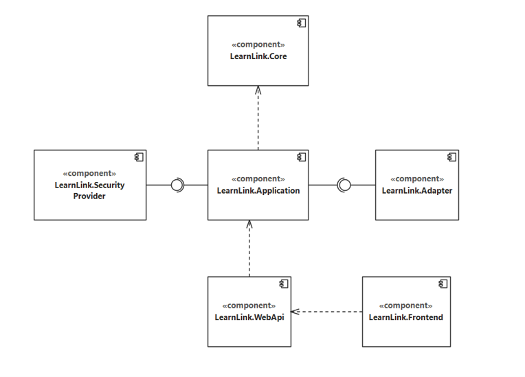
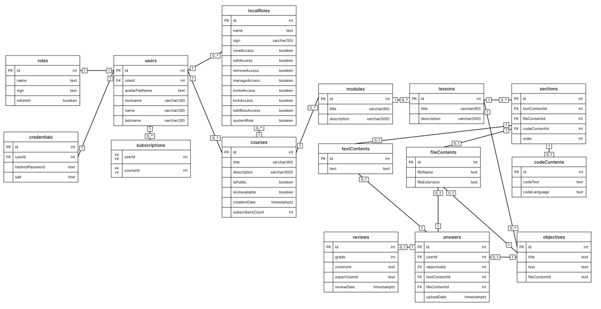
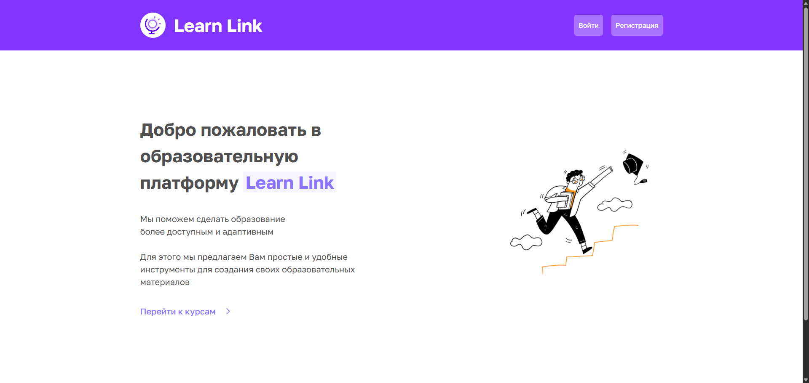
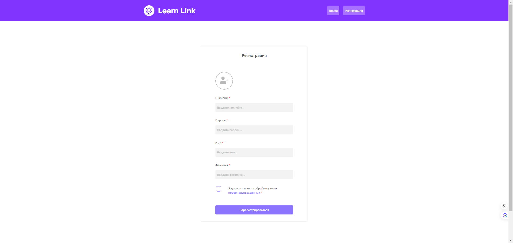
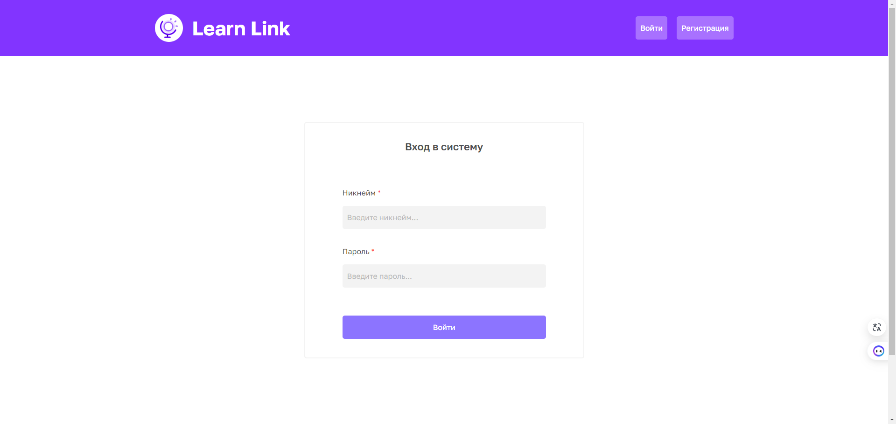
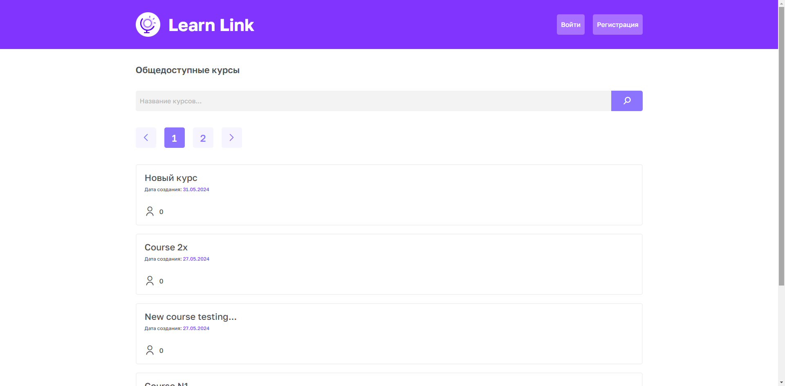
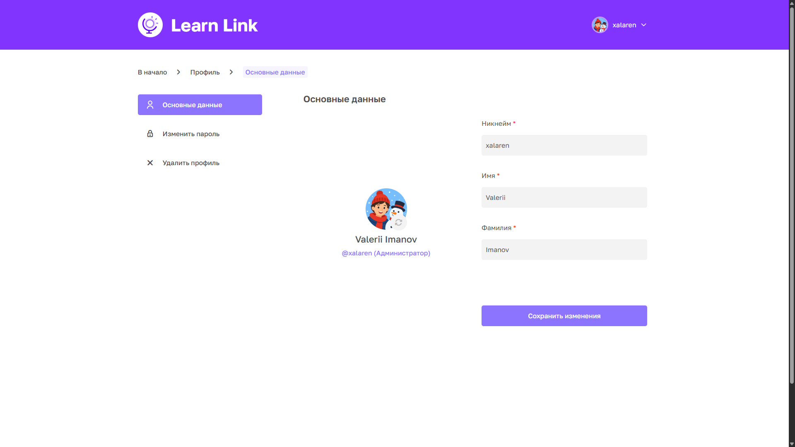
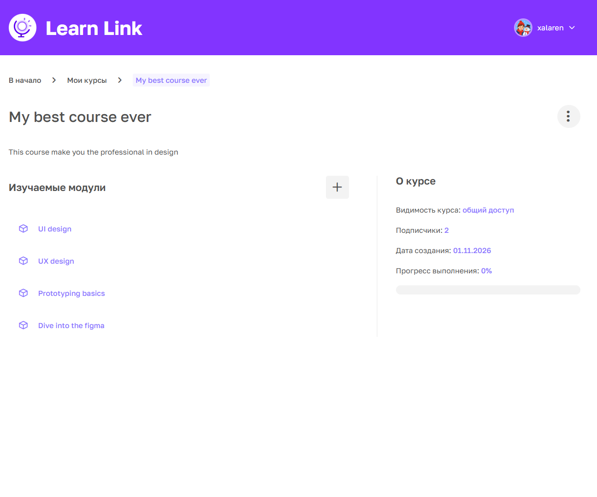
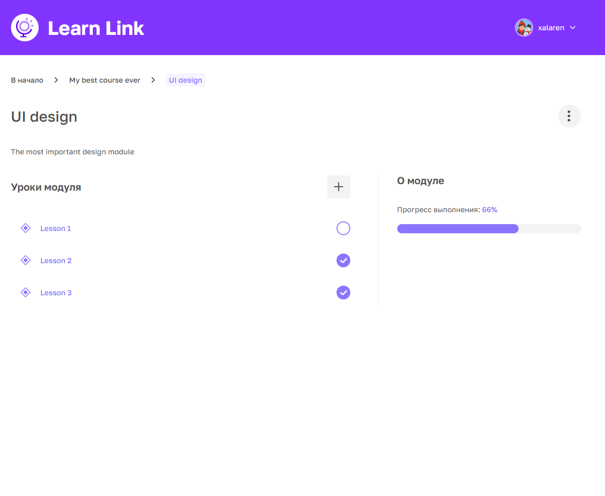
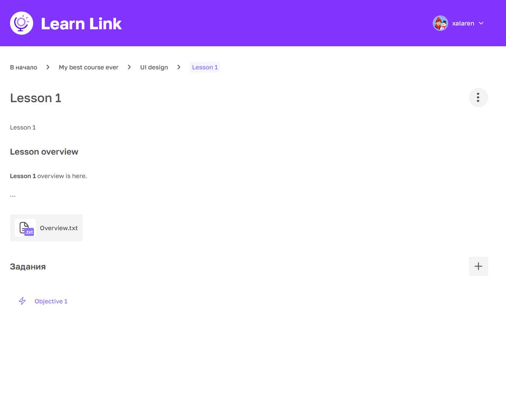

# LearnLink

  

  

    Full-stack educational platform for creating, publishing, and managing online courses.
  

## Overview 

<b>LearnLink</b> educational platform is designed to create, manage, and distribute digital educational courses.
The objectives of the system are as follows:

1)    To create an accessible and user-friendly learning platform that allows users to study course materials at any time, regardless of their location;
2)	To provide course authors with the ability to create, edit, and publish instructional materials in the form of educational courses;
3)    To configure access rights and define user roles, ensuring data security and confidentiality.

## Key Features
- User authentication and authorization
- Course creation and management
- Course subscriptions
- Role-based access control
- Learning progress tracking
- Assignments and reviews
- User-friendly adaptive design

## Architecture
Solution architecture is followed `Clean architecture`
- LearnLink.Core
- LearnLink.Application
- LearnLink.Adapter
- LearnLink.SecurityProvider
- LearnLink.Shared
- LearnLink.WebApi
- LearnLink.Frontend

## Technology Stack
C#, ASP.NET Core, Entity Framework Core, PostgreSQL, React, TypeScript, Redux Toolkit.

Administration tool: Razor Pages

## Entity Relationship Diagram

## Screenshots 

### Introduction to platform

### Register form

### Login form

### Home page

### Profile overview

### Course overview

### Module overview

### Lesson overview

## Getting Started

1) Download repository from GitHub.
2) Install npm packages at `/frontend` folder via `npm install`
3) Change `LearnLink.WebApi/appsettings.json`

    * Change `Secret Key` to your strong secret key
    * Change `LaunchUrl` and `ClientUrl` to yours, if needed

3) Configure database and run application by following the instructions below.

## Database Setup

1) Install `postgres` DBMS on host machine.
2) Create specified user for application connection
3) Make changes to  `LearnLink.WebApi/appsettings.json` providing new connection string into `PostgreSqlConnection` field

## Running the Application

1) Go to `LearnLink.WebApi` and run web-api via `dotnet run`
2) Go to `frontend` and run client application via `npm run dev`
3) Follow the provided `url` and you're done!